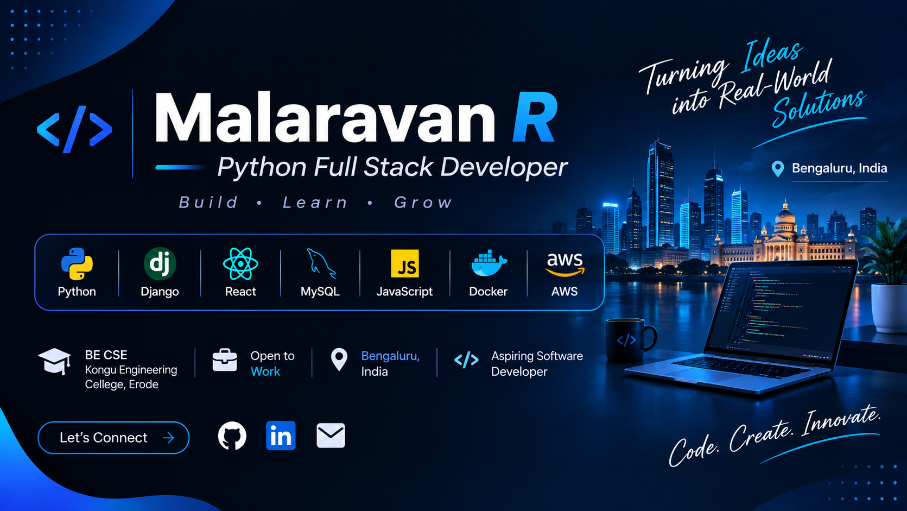

  

<h2 align="center">Hi 👋, I'm Malaravan R</h2>

<h3 align="center">Python Full Stack Developer | Bengaluru, India</h3>

  Building real-world web applications using Python, Django, React and MySQL.

  <!--  -->
  
  

---

### 👨‍💻 About Me

- 🎓 BE Computer Science and Engineering
- 💻 Python Full Stack Developer
- 🌱 Learning Django, React and REST APIs
- 🔭 Interested in developing real-world applications
- 📍 Bengaluru, India
- 📫 Email: malaravan236@gmail.com

### 🛠️ Technical Skills

  

